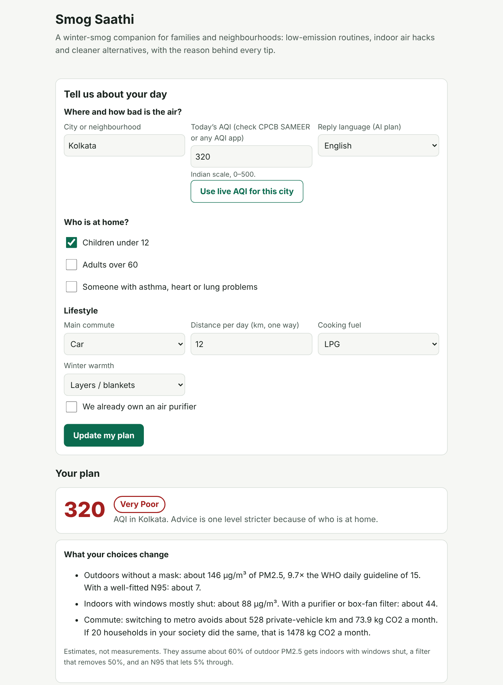
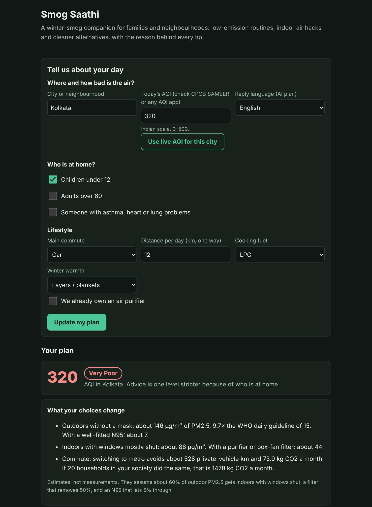
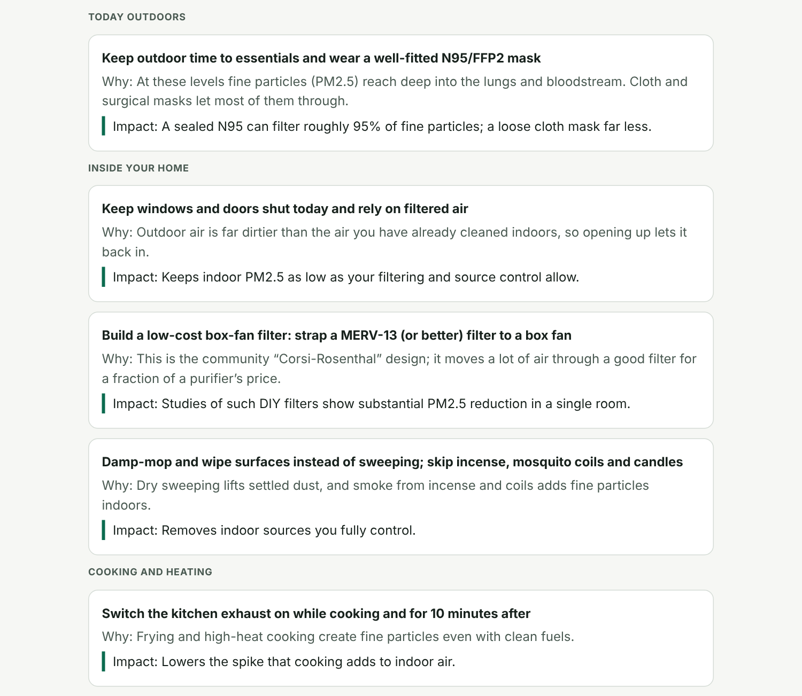
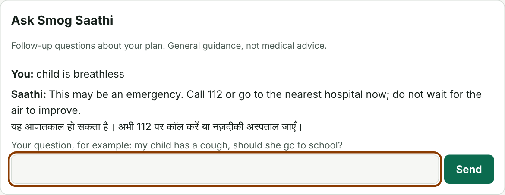
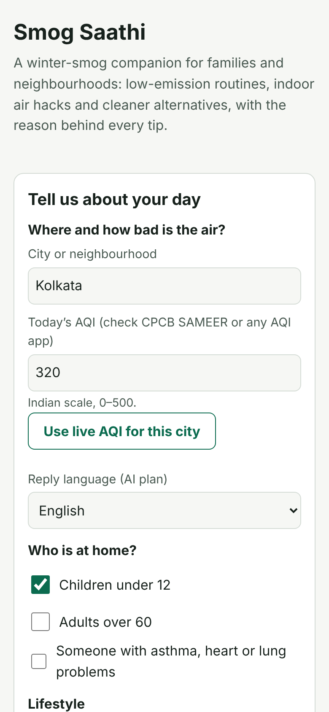

# Smog Saathi

**Live demo:** https://smog-saathi.vercel.app

A GenAI assistant that helps families and communities navigate severe winter smog. It turns today's AQI and a household's lifestyle into low-emission routines, indoor air-quality hacks and cleaner alternatives, and explains the **why** and the **direct impact** of every suggestion.

## Features
- **Live AQI for your city:** one click geocodes the city and estimates the Indian AQI from live PM2.5 (Open-Meteo, no key needed, cached 10 minutes)
- **Tailored plan:** location notes (Delhi-NCR, Kolkata, Mumbai, Indo-Gangetic plain), household (children, elderly, respiratory conditions), commute, cooking fuel, heating and purifier
- **Why + Impact on every tip**, plus a "What your choices change" panel: outdoor vs indoor PM2.5 against the WHO guideline, with and without a mask or filter; vehicle-km and CO2 avoided, scaled to a housing society
- **Community actions:** RWA air-quality champion, carpool and no-idling, construction dust, a shared clean-air room, checking on elderly neighbours
- **AI one-day plan and follow-up chat** (Groq, xAI Grok or Gemini, server-side) in English, Hinglish, Hindi or Bengali, grounded in the same tips and impact numbers
- **Fixed emergency guidance:** messages describing breathlessness, chest pain and similar symptoms always get a "call 112" notice first, even if the AI fails
- Everything except the AI works with no key

## Screenshots
Captured from a local run of the app (no AI key configured, so the AI plan is not shown here; the live demo shows it).

| Plan and impact panel | Dark mode |
|---|---|
|  |  |



| Fixed emergency notice in chat | Mobile layout |
|---|---|
|  |  |

## Run locally
```bash
npm install                  # dev tools only; the app has zero runtime dependencies
export GROQ_API_KEY=gsk_...  # optional; PowerShell: $env:GROQ_API_KEY="gsk_..."
export LLM_PROVIDER=groq     # groq | xai | gemini
npm start                    # http://localhost:3000
npm run check                # lint + type-check + format check + tests (Node 20+)
npm run format               # auto-format with Prettier
```

## Architecture
Small modules, one job each. Browser code and server code share the same pure logic.
```
index.html              semantic, accessible markup
src/                    everything the browser loads
  client.js             entry point: wires the page to the UI modules
  styles.css            design tokens, light/dark, reduced motion
  logic.js              public API of the shared logic (re-exports src/shared)
  shared/               pure logic, no DOM and no I/O (also used by the server)
    constants.js        limits and lookup tables
    numbers.js          clamp, toNum
    sanitize.js         untrusted input -> safe profile, text and chat history
    aqi.js              AQI bands, PM2.5 <-> AQI (CPCB breakpoints)
    impact.js           assumption-labelled impact estimates
    locations.js        city-specific notes
    plan.js             rule-based plan engine
    prompts.js          LLM prompts (vetted tips + impact numbers)
    safety.js           hard-coded emergency notice
    types.js            JSDoc types
  ui/                   DOM code only (textContent, never innerHTML)
    dom.js  plan-view.js  live-aqi.js  ai-plan.js  chat.js
lib/                    server code
  routes.js             the three API routes + request handler
  llm.js                Gemini / xAI Grok / Groq requests and error mapping
  aqi-service.js        live AQI from Open-Meteo, cached
  http.js  static.js    response helpers, safe static file serving
  rate-limit.js         per-IP limiter and daily AI budget
  config.js  errors.js  settings read at call time, HttpError
backend.js              local server entry (npm start)
api/*.js                Vercel serverless entries (re-export the shared handler)
scripts/                build step that copies browser files into public/
tests/                  node:test unit and HTTP tests (upstream services faked)
```

## How it maps to the judging parameters
| Parameter | What was done |
|---|---|
| Problem alignment | Location-aware live AQI and city notes; routines, indoor hacks and sustainable alternatives for each household; community actions; every tip explains Why and Impact, quantified in an assumptions-labelled impact panel; GenAI plan and chat |
| Code quality | Small single-purpose functions, named constants, JSDoc types checked by `tsc` in strict mode (checkJs, noImplicitAny, strictNullChecks), strict ESLint (curly, no-shadow, no-param-reassign, eqeqeq), Prettier-enforced formatting, EditorConfig, `.gitattributes` (LF line endings), shared pure logic for browser and server, zero runtime dependencies |
| Security | API keys only on the server; CSP, nosniff, no `innerHTML`; whitelisted inputs; sanitised chat history (6 turns, 500 chars); per-route body limits and per-IP rate limits (10/min for AI, 30/min for AQI); daily AI budget (`AI_DAILY_LIMIT`, default 500); upstream timeouts; no-store API responses; prompts treat user data as data |
| Efficiency | Static files gzipped once with ETag revalidation (local server), CDN on Vercel, 10-minute AQI cache with shared in-flight lookups, debounced rendering, cancellable AI requests, capped history and output tokens |
| Testing | 50 `node:test` tests, about 99% line coverage (`npm run test:coverage`): AQI maths, sanitisers, plan rules, impact model, rate limiter, emergency notice, HTTP behaviour, Vercel handler behaviour, and the Open-Meteo, Groq, xAI and Gemini paths with faked upstreams. CI runs lint, type-check and tests |
| Accessibility | Skip link, labelled fieldsets, 44 px targets, live regions (`role="status"`, `role="log"`), visible focus, AQI band shown as text not just colour, dark mode, reduced motion |

## Deploy on Vercel
Static files are served from `public/` (built by `npm run build`) and the API runs as serverless functions in `api/`.
```bash
npm i -g vercel
vercel link
vercel env add GROQ_API_KEY --environment production   # or XAI_API_KEY / GEMINI_API_KEY
vercel env add LLM_PROVIDER --environment production   # groq | xai | gemini
vercel env add LLM_MODEL --environment production      # for example openai/gpt-oss-120b
vercel env add TRUST_PROXY --environment production    # 1
vercel --prod
```
- `vercel.json` sets `"framework": null`. Without it Vercel detects a Node backend and treats the API folder as secondary.
- Do not name files `app.js`, `server.js` or `index.js` at the root or in `src/`: Vercel treats those names as server entry points. That is why the server file is `backend.js` and the browser script is `src/client.js`.
- Rate limits and the daily AI budget live in memory, so on serverless they apply per warm instance, not globally. Use Redis or Vercel KV for strict global limits.
- Any Node host (Render, Railway, Fly) also works: start command `npm start`, one provider key, `TRUST_PROXY=1`.

## Limitations
- Impact numbers are illustrative estimates with stated assumptions (60% of outdoor PM2.5 indoors, 50% filter removal, 5% N95 leakage).
- Live AQI is estimated from PM2.5 with CPCB breakpoints; it is not an official CPCB reading.
- Emergency detection is keyword-based and cannot catch every phrasing or language.
- AI wording varies between runs; it is constrained by vetted tips and impact figures, but not guaranteed.
- General guidance, not medical advice.

Air-quality data: Open-Meteo (CC BY 4.0).
